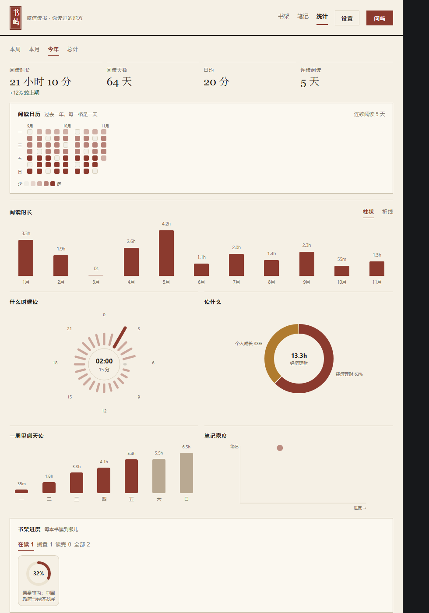
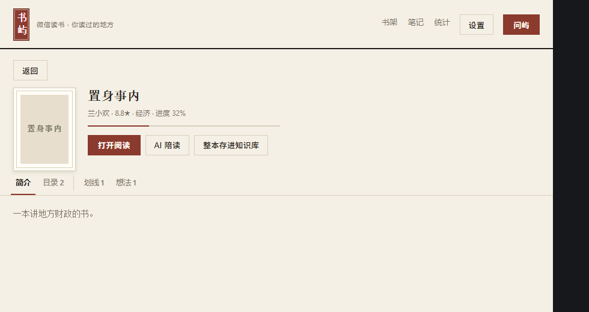
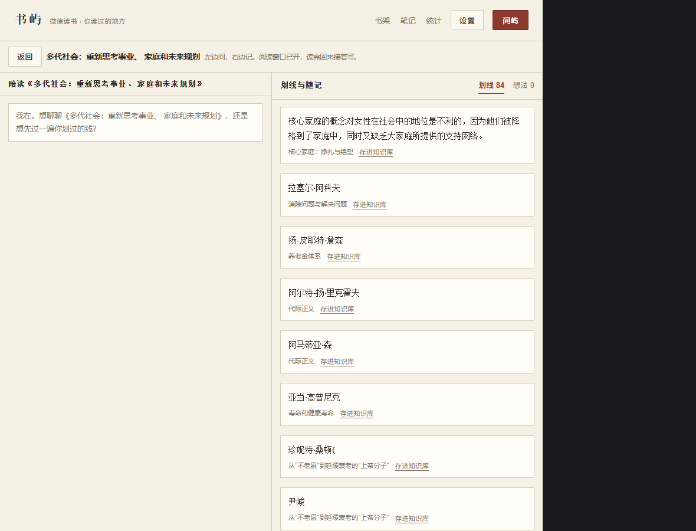

# 书屿 · WeRead Shelf for DSH

[](https://github.com/SaltedFish-ZZJ/dsh-weread-shelf/actions/workflows/ci.yml)
[](LICENSE)

**把微信读书搬进 DSH 的左侧栏**：书架 → 独立窗口阅读 → 回来陪读 AI → 划线想法一路写进 Obsidian。

A WeRead (微信读书) shelf plugin for [DSH](https://deepseek.com): browse your shelf, open a book in a chrome-less reader window, ask an AI companion about it, and file highlights into your Obsidian vault.


| 统计 | 详情 |
| --- | --- |
|  |  |



## 功能

- **书架**：微信读书官方 Agent Skill API（`wrk-` Key）。全部书籍 + 书单文件夹 + 四种分组（平铺 / 分类 / 进度 / 首字母）+ 在读·读完·未开始筛选 + 全站书城检索。
- **今日带**：日期、今天读到 / 本周读到 / 连续阅读，今天翻开的书，和一条「旧句重逢」的划线（可换一句、换一本）。
- **打开阅读**：用 Chrome `--app` 开一个没有地址栏的独立窗口——不是内嵌 iframe（微信读书会拦 frame，且有封号提示）。
- **陪读台**：点「打开阅读」后自动进入左右分栏。左栏问这本书的 AI，右栏是这本书的划线、想法和随手记。
- **全局 AI「问屿」**：跨书问，推荐、串联、找共同主题。
- **写进知识库**：单条划线 / 想法 / AI 回答 / 随手记都能落进 Obsidian；整本书可一次归档，自动去重、按章节分组、维护书单 MOC。
- **统计**：阅读日历热力图、连续阅读天数、趋势（柱 / 折线）、24 小时极坐标钟、分类环形、周分布、笔记密度散点、书架进度环墙。
- **给 Agent 用**：注册 4 个只读工具（`weread_shelf` / `weread_notes` / `weread_stats` / `weread_search`），对话里可以直接问「我书架里有哪些经济类的书」。

## 安装

需要 DSH 桌面版（0.2.x）。插件是本地 bundle，装上就出现在左侧栏。

```bash
git clone https://github.com/SaltedFish-ZZJ/dsh-weread-shelf.git
```

然后在 DSH 里安装这个目录（二选一）：

- **让 Agent 装**：跟 Agent 说「把 `D:\path\to\dsh-weread-shelf` 作为 bundle 装上并启用」，它会调用 `plugin_manager install_bundle`。
- **插件面板装**：设置 → 插件 → 从本地路径安装，选中克隆下来的目录。

装好后左侧栏出现「书屿」图标；首次打开会让你填 API Key。

### 拿 API Key

微信读书 App →「我」→ 设置 → 微信读书 Skill → 获取 API Key（形如 `wrk-xxxxxxxx`）。

Key 存在 DSH 的 credentials 服务里，**不写进本仓库、也不进配置文件**。

## 配置

面板右上「设置」：

| 项 | 说明 |
| --- | --- |
| 打开阅读后自动进入陪读台 | 默认开 |
| Obsidian 库根 / 子目录 | 默认 `personal/书屿`（相对库根） |
| 微信读书 API Key | 已连接 / 断开、替换 |
| 问屿的 AI | 跟随 DSH 模型，或自定义 OpenAI 兼容接口 |

库根默认 `~/Obsidian`（没配过的话请自己在设置里改成你的库路径），写在宿主侧 `~/.dsh-weread-shelf/settings.json`——这是普通配置，不含密钥。

## AI 走哪个模型

默认走宿主 `llm` 服务 + `agentDefaultModel.currentSelection()`，也就是 **DSH 里当前选中的模型**；消耗的是它的 token，与微信读书无关（`wrk-` Key 只取数据，不产生 token）。

也可以在「设置 → 问屿的 AI」里切到**自定义接口**：填一个 OpenAI 兼容的 base URL（如 `https://api.deepseek.com/v1`）、模型名和一个接口 Key。宿主会直接 `POST <base>/chat/completions` 并按 SSE 解析，此时消耗的是那家接口的 token，DSH 的模型不参与。接口 Key 存在 credentials（`weread/ai-key`），不落配置文件。

单书提问的上下文约 3.5k 字符（简介 + 目录 + 前 60 条划线 + 前 30 条想法），输出上限 1200 token，历史只带最近 8 轮。

## 数据与隐私

- 只调用微信读书官方 Agent Skill 网关（`POST i.weread.qq.com/api/agent/gateway`），17 个接口全部只读：不改进度、不加书架、不导出正文。
- 除微信读书与你在设置里指定的 AI 接口外，插件不向任何第三方发请求。
- 封面走 `/api/weread/cover` 代理（白名单：`*.qq.com` / `*.qpic.cn` / `*.weixin.qq.com` / `*.myqcloud.com`），只为绕开图片防盗链。
- 写入 Obsidian 的内容只有你点「存进知识库 / 整本存进知识库 / 随手记」时才会发生。

## 免责声明

非官方项目，与腾讯 / 微信读书无关。接口来自微信读书对外开放的 Agent Skill，插件本身不破解、不模拟登录、不绕过风控。微信读书会提示「请勿使用第三方插件」——这也是本项目用独立窗口而不是内嵌 iframe 的原因。使用风险自负。

## 开发

单文件客户端，没有构建步骤（`client.js` 是 `window.__ModuleLoader__` 形式的纯 JS）。

```bash
node tests/smoke.mjs                          # 无头渲染：各视图 + 完整点击流 + 断言
node tests/host.mjs                           # 桩 ctx 跑真路由（JSON 契约）
node tests/host.mjs --live                    # 再打真网关（需本机已存 Key）
node tests/shots.mjs                          # 用真实数据导出预览 HTML + headless Chrome 截图
```

`tests/shots.mjs` 会通过插件自己的路由抓真实书架/统计/日历数据、把封面内联成 data URI，再交给 `smoke.mjs --data` 渲染成静态页——`docs/` 里的图就是这么来的。

## 目录

```
index.js         宿主半：/api/weread 路由（state key shelf book notes stats calendar search
                 open ask save archive settings ai）、4 个只读工具、Obsidian 写入
weread.js        官方网关客户端：业务参数平铺顶层 + skill_version，带 TTL 缓存
client.js        面板半：window.__ModuleLoader__ 单文件（sidebar.panellist + main 两个槽位）
cordis.patch.yml bundle 声明；package.json / locale / icon.svg
tests/           smoke.mjs（无头渲染 + 静态预览）、host.mjs（路由端到端）、
                 shots.mjs（真实数据截图）、credentials.mjs（读 Key 的小工具）
```

CI 跑的是两个离线测试（`node tests/smoke.mjs`、`node tests/host.mjs`），不需要 API Key；`--live` 与 `shots` 只在本地用。

## 已知边界与路线图

现在还不能做的：

- **划线定位「去原文」**：微信读书有 `weread://bestbookmark` 深链，但需要确切的章节 + 字符区间；目前只做到打开整本。
- **年度书墙、笔记日历·那年今日**：数据都在手边（`/shelf/sync` + `/user/notebooks`），只是还没画。
- **本地增量缓存**：每次打开面板都会重新拉书架；书多的人会慢。
- **路由鉴权**：`/api/weread/*` 直接注册在宿主 webServer 上（本机回环），未走 connection 层的会话校验。
- **AI 读不到正文**：官方接口不给正文，所以陪读只能基于简介 / 目录 / 划线 / 想法；也还不能回读 Obsidian 里已有的笔记。
- 单账号；没有安装包、没有崩溃日志。

Pull request 都欢迎。

## 版本

完整记录见 [CHANGELOG.md](CHANGELOG.md)。

- 0.9.5 — 封面加载重做：小队列取图（6 并发、失败重试）转 object URL，不再一次甩 81 个 ``
- 0.9.4 — 开源收尾：CI、CHANGELOG、去掉机器相关路径
- 0.9.3 — 开源就绪：MIT LICENSE、README、真实数据截图
- 0.9.2 — 封面修复（放行腾讯 COS 域名）+ 书架分组（平铺 / 分类 / 进度 / 首字母）
- 0.9.1 — 今日并入书架：改成书架顶部的「今日带」
- 0.9.0 — 今日首屏：今天读到 / 连续阅读 / 今天翻开的书 / 旧句重逢
- 0.8.0 — 书架书单：文件夹拼贴卡 + 文件夹页 + 平铺去重
- 0.7.0 — 柔化纸本、书名横排、问屿可切自定义 OpenAI 兼容接口
- 0.6.0 — 纸本主题（米黄纸面 / 宋体正文 / 暗红印章 / 统计插图框）
- 0.5.0 — Key 管理、整本归档进 Obsidian
- 0.4.0 — 统计仪表盘、书城检索修复
- 0.3.0 — 去掉内嵌阅读，改 Chrome 独立窗口 + 陪读台

## 致谢

- [teng-lin/weread-omni](https://github.com/teng-lin/weread-omni)、[shiquda/weread-cli](https://github.com/shiquda/weread-cli)：早期摸清官方网关的用法。
- [finlater/weread.koplugin](https://github.com/finlater/weread.koplugin)：书架交互与统计口径的参考。
- [zhaohongxuan/dsh-weread](https://github.com/zhaohongxuan/dsh-weread)：同为 DSH 微信读书插件，书单与「今日」的思路受它启发。

## License

MIT